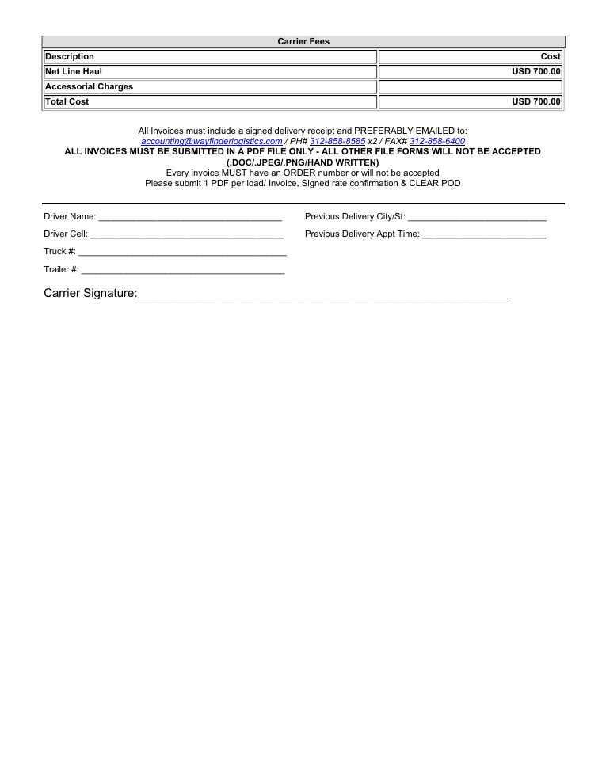
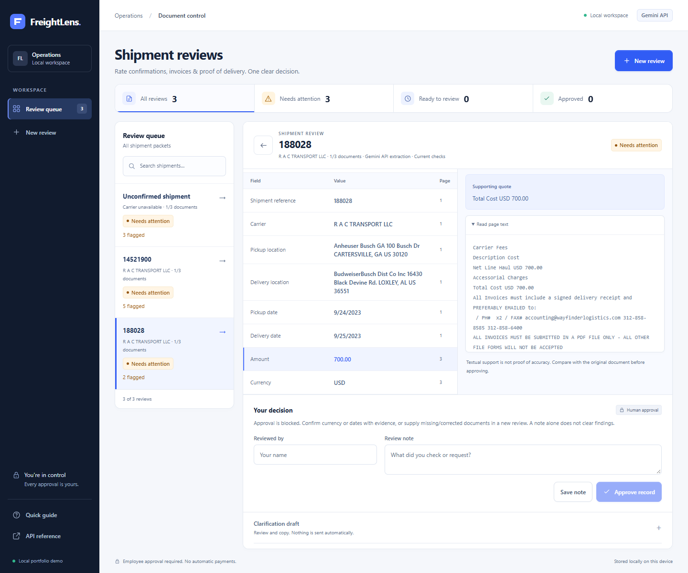
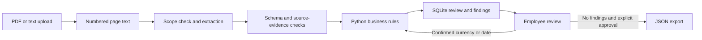

# FreightLens

[](https://github.com/redajausef/freightlens/actions/workflows/ci.yml)

**AI-assisted freight document review, with source evidence and employee approval.**

FreightLens helps an operations employee review a shipment's rate confirmation, invoice
and proof of delivery. It extracts structured fields, checks for discrepancies, and prepares
a clarification draft. Employees can confirm ambiguous currency or dates while preserving
the original extraction. Export requires a separate employee approval.

**Python · FastAPI · Gemini · Pydantic · SQLite · Vanilla JavaScript**

Status: working local prototype. **148 automated tests pass with 97.95% line coverage**
on Windows/Python 3.14. [Verification](docs/verification.md) ·
[Reviewer guide](docs/reviewer-guide.md) · [Architecture](docs/architecture.md)

## A public PDF, before and after extraction

This example uses an unchanged, three-page [Wayfinder rate confirmation](https://www.grouprac.com/Documents/188028Rate%20Confirmation.pdf)
publicly hosted by GroupRAC. The left image is a direct rendering of page 3; the right
image shows the actual saved Gemini result in FreightLens. Click either image to enlarge it.

| Original PDF: page 3 | FreightLens: extracted fields and supporting quote |
|---|---|
| [](docs/assets/public-pdf-demo/original-wayfinder-page-3.png) | [](docs/assets/public-pdf-demo/04-source-and-approval-gate.png) |

The printed **Total Cost USD 700.00** becomes `amount: 700.00`, `currency: USD`, and a
page-3 supporting quote. The load reference, carrier, locations and dates are also extracted.
Python checks that each accepted quote/value is supported by the cited page.

| External document | Recorded result | What still needs review |
|---|---|---|
| Wayfinder, load 188028 | 8 checked field values matched, including USD 700.00 | Invoice and delivery record were not supplied |
| RXO, load 14521900 | 7 checked field values matched, including 775.00 | Currency code, two-digit years, missing invoice/POD |
| FedEx invoice guide | Earlier model extraction was inconsistent | Current scope guard catches this guide before a new extraction request |

The two rate confirmations belong to **different shipments**. Missing invoice/POD findings
describe our incomplete test uploads; they do not mean those documents should be inside the
rate-confirmation PDF. Currency/date findings reflect this prototype's validation policy.
This small development set does not establish general extraction accuracy or real business usage.

[Full illustrated walkthrough](docs/public-pdf-demo.md) ·
[Live evaluation and original sources](docs/external-pdf-evaluation.md) ·
[Recorded results](docs/external-pdf-live-results.json)

## Try the complete workflow without an API key

Requires Python 3.11 or newer. Run from the repository root.

**Windows / PowerShell**

```powershell
python -m venv .venv
.\.venv\Scripts\python.exe -m pip install -r requirements-dev.lock
.\.venv\Scripts\python.exe -m pip install --no-deps -e .
.\.venv\Scripts\python.exe run.py
```

**macOS / Linux**

```bash
python3 -m venv .venv
.venv/bin/python -m pip install -r requirements-dev.lock
.venv/bin/python -m pip install --no-deps -e .
.venv/bin/python run.py
```

Open **http://127.0.0.1:8765**. Interactive API documentation is at `/docs`.
The default mode is an offline labeled-field parser; it makes no AI requests.
Windows/Python 3.14 was tested locally. Linux GitHub Actions checks also passed for
Python 3.11 and 3.14 ([recorded run](https://github.com/redajausef/freightlens/actions/runs/38795050974)).
For runtime-only installation, use `pip install -e .` instead
of installing the development dependencies.

Choose **New review** and try a built-in fictional packet, or upload the corresponding
[sample PDFs](samples/). These samples are explicitly synthetic and exercise the complete workflow.

| Scenario | Expected behavior |
|---|---|
| Matching documents | USD 2,000.00 agreed and invoiced; explicit employee approval enables JSON export |
| Charge mismatch | USD 2,000.00 agreed vs USD 2,300.00 invoiced; USD 300.00 discrepancy blocks approval |
| Missing delivery record | Missing POD blocks approval even when the two supplied amounts match |

[Step-by-step sample demo and expected results](docs/demo-walkthrough.md)

## Enable real Gemini extraction

Copy `.env.example` to `.env`, add your own API key locally, and set:

```dotenv
FREIGHTLENS_PROVIDER=gemini
GEMINI_API_KEY=your_key_here
GEMINI_MODEL=gemini-3.1-flash-lite
```

Restart the server and confirm that the interface shows **Gemini API**. Upload a PDF to
invoke the model. Demo shortcuts remain exclusive to offline mode. Quota and billing are
controlled by your Google project; the app does not enable billing or switch models on failure.

The repository includes source links and recorded results, rather than the external PDF files.
To download the exact public examples and reproduce the evaluation:

```powershell
.\.venv\Scripts\python.exe scripts/download_public_samples.py
.\.venv\Scripts\python.exe scripts/evaluate_public_pdfs.py --pdf-dir data/public-pdfs --live
```

Use `.venv/bin/python` for these commands on macOS/Linux. Downloads are checked against the
recorded original hashes and stored under ignored `data/`. Running `--live` sends extracted
page text to Gemini; it can consume your project's API quota. Without `--live`, the evaluation
script runs the offline baseline.

[Configuration, provider details and troubleshooting](docs/configuration.md)

## Clarify a field without overwriting the AI result

Select **Clarify this field** on a currency/date finding, or **Confirm currency or dates**
beside the extracted fields. Supply the verified value, source page, exact quote, your name
and a reason. Original AI values remain stored; employee confirmations and their history
are separate. Every change reruns the checks. Approval is still a separate decision.


In an isolated simulation using the saved RXO extraction, three confirmations reduced
findings from **5 to 2**: the missing invoice and POD remained. Those assumed interpretations
were not applied to the actual public review. [Workflow and test evidence](docs/field-confirmations.md)

## How it works



- Amounts use `Decimal`; Python compares amounts, currencies, references, locations and dates.
- Unsupported source quotes/values are discarded. Detected invoice guides/bundles stay blocked.
- Original fields, employee confirmations, processing revisions and review history are stored.
- Stale edits are rejected. Missing documents and unrelated discrepancies cannot be cleared by a note.
- Clarification emails are drafts only. The app sends no emails, payments or business webhooks.

Source code is organized in `src/freightlens/`: API routes, ingestion, extraction, scope
checks, confirmations, rules, workflow and repository modules. There is no frontend build step.
[Architecture and module map](docs/architecture.md) · [Java-to-Python code tour](docs/java-to-python.md)

## Run the checks

```powershell
.\.venv\Scripts\python.exe -m pytest --cov=freightlens --cov-fail-under=80
.\.venv\Scripts\python.exe -m ruff check .
.\.venv\Scripts\python.exe -m ruff format --check .
.\.venv\Scripts\python.exe -m pyright --pythonpath .\.venv\Scripts\python.exe src run.py
```

The suite covers validation, grounding, provider failures, source-checked confirmations,
stale edits, persistence, approval/export gates and upload limits. Software test coverage
is separate from AI accuracy. [Detailed evidence](docs/verification.md)

## Current boundaries

- Single-user, loopback-only prototype; reviewer names are self-reported. No hosted authentication.
- Reads text-bearing PDFs. Scans need OCR first; signatures and authenticity are not verified.
- Source grounding and scope heuristics can miss semantic errors or unfamiliar layouts.
- Only currency/dates support employee confirmation; other corrections require a new packet.
- No TMS integration, RAG assistant, currency conversion or measured operational savings.

Runtime databases and keys stay outside version control. Demo fixtures are synthetic;
public-document ownership and provenance are documented in [third-party notices](THIRD_PARTY_NOTICES.md).

## Development and next steps

Developed with Codex and ECC assistance for architecture, implementation, testing and review.
ECC supports development; it is not an agent team running inside FreightLens. This is a
portfolio prototype, not a system currently operating a transport company's business.

Next steps focus on a broader held-out evaluation set, OCR and approved business integrations.
[Roadmap](docs/roadmap.md) · [Repository upload instructions](docs/publishing.md)
