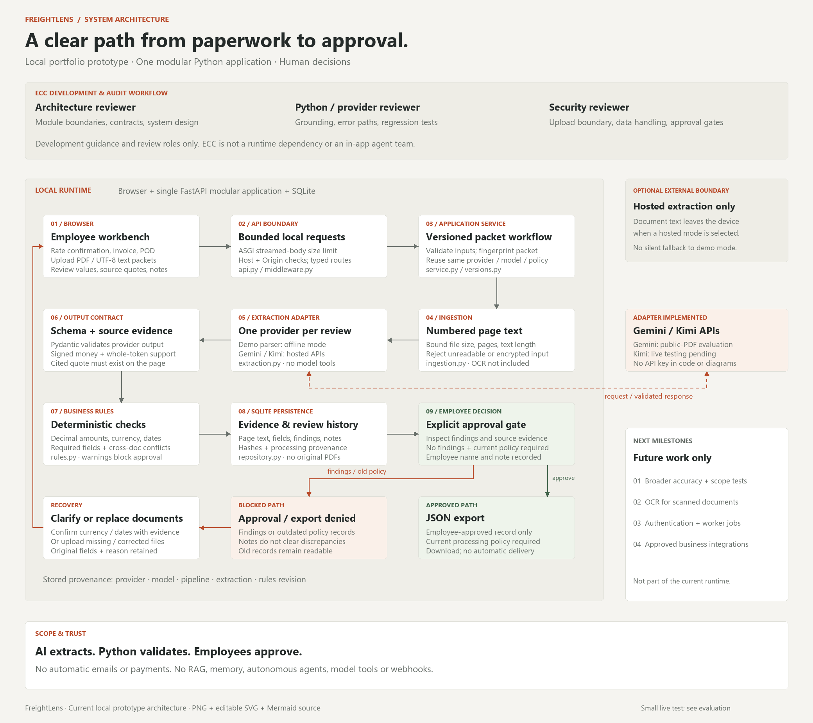

# ECC architecture audit

Date: 2026-10-15. Target: FreightLens local portfolio prototype, pipeline `2026-10-15.2`.

## Severity-ranked findings

Severity describes the reproduced pre-fix behavior. Seven findings are fixed in this revision;
PDF parser resource isolation remains deferred. Synthetic documents, temporary databases and
mocked provider responses were used. No live model request or real business document was used.

| ID | Severity | Reproduced failure | Resolution and evidence |
|---|---|---|---|
| A1 | High | A positive model value `2000.00` was accepted against source `-2,000.00` or `(2,000.00)`. A simulated model mistake could produce a clean review. | Fixed: monetary candidates retain sign/accounting context. Negative source tokens cannot support a positive amount. `extraction.py:53`; regression tests include a full review and blocked approval. |
| A2 | High | `FL-1` was supported by `FL-10` or `FL-1-A`; `USD` was supported by `USDT`. | Fixed: field-aware complete-token boundaries, including identifier punctuation. `extraction.py:75`; five prefix regression cases. |
| A3 | Medium | An unrelated invalid account/tax number before a valid amount caused the valid amount to be discarded. | Fixed: candidates are parsed independently; one invalid token no longer aborts the search. `extraction.py:53`; two regression cases. |
| A4 | Medium | A malformed successful provider envelope such as `choices=[null]` raised an uncaught attribute error. | Fixed: validate the envelope, choices and message types before access; return a controlled extraction failure. `extraction.py:206`; four malformed-envelope cases. |
| A5 | Medium | Delivery before pickup inside a rate confirmation could pass if POD chronology looked valid. Compact/week dates also passed the documented calendar-date format. | Fixed: strict `YYYY-MM-DD` and per-document chronology, while retaining rate-pickup/POD-delivery checks. Legitimate actual delivery later than planned is permitted. `rules.py:16,69,139`; four date regression cases. |
| A6 | Medium | A request without Content-Length was fully spooled before the endpoint applied file limits. | Fixed: outer ASGI middleware counts actual bytes before multipart parsing, returns 413 and preserves partial-file cleanup. `middleware.py:12`; omitted-length test and direct multi-chunk ASGI cleanup test. |
| A7 | Medium | Saved review reuse omitted validation-policy revisions; model/rule provenance was absent. A corrected policy could reuse a prior clean result. | Fixed: pipeline revision in fingerprint, persisted provider/model/extraction/rules revisions, and server/UI recheck gates for legacy records. `service.py:29,61`, `models.py:75`, `api.py:82`; revision transition and legacy approval/export tests. |
| A8 | Medium | Small compressed PDFs can expand or take excessive CPU during `extract_text()` before final text limits are checked. | Deferred production requirement: isolate parsing with time/memory limits before accepting untrusted business attachments. Byte/page/text caps are not a hard parser resource bound. `ingestion.py:39,46`; source-order finding, no resource-exhaustion stress test. |

Source paths in the table are relative to `src/freightlens/`.
Executable regression evidence is in [test_audit_regressions.py](../tests/test_audit_regressions.py)
and [test_policy_and_limits.py](../tests/test_policy_and_limits.py).
The first regression run reproduced 21 failures and 2 passes before fixes; subsequent policy
and cleanup tests expanded the suite. The final suite has **76 passing tests and 97.87% line
coverage**. See [verification notes](verification.md) for scope and limitations.

## Architecture diagnosis

The important failures occurred between model output and business decisions, and when persisted
decisions were reused. Fixing prompts alone would leave these failures possible. Typed envelopes,
textual support checks, deterministic business rules and versioned persisted results are the
appropriate boundaries. Textual grounding still cannot prove semantic accuracy or authenticity.

Keep the single modular Python application. Its current responsibilities are separated into
transport, ingestion, extraction, rules, workflow and persistence. Splitting these into services
would add infrastructure without fixing the demonstrated correctness problems. SQLite and a static
same-origin interface fit the current single-user scope. A queue becomes useful when real usage
requires independent processing, concurrency or enforced parser resource limits.

ECC's applicable audit layers were system prompt, answer shaping/schema validation, rendering,
retry behavior and persistence. Session history, long-term model memory, distillation, recall,
tool selection/execution and autonomous repair are absent. FreightLens is a bounded extraction
workflow, not an autonomous multi-agent runtime. Kimi has no tools or approval authority. Its
adapter performs bounded HTTP retries; it does not silently repair outputs with another model
or fall back to demo extraction.

The security review confirmed parameterized SQLite operations, transactional approvals, local
Host/Origin checks, a fixed provider endpoint, environment-based keys and text rendering in the UI.
These controls apply to the local prototype and do not establish production security. Reviewer
names are self-reported; there is no authentication or tamper-proof audit history.

## Ordered changes and next evidence

1. **Completed:** repair sign/value grounding and candidate parsing, with reproduced regressions.
2. **Completed:** validate provider envelopes and document chronology in code.
3. **Completed:** bound actual request bytes and prove partial multipart cleanup.
4. **Completed:** persist processing provenance, change packet reuse keys, and require a fresh
   review under the current policy before approval/export. Preserve old records for reading.
5. **Next:** run Kimi with synthetic data and a real account key, then measure extraction on a
   separately labeled set of varied documents. Mock responses cannot establish model accuracy.
6. **Before untrusted/hosted business usage:** parser process resource limits, authentication,
   retention/backups, observability and bounded jobs. Add OCR with page provenance for scans.
7. **Later business capability:** approval-gated integration and cross-packet invoice identity
   checks. RAG and a company knowledge assistant are separate milestones.

Verdict: **suitable foundation for a local portfolio demonstration after the targeted fixes**.
Live extraction quality and production readiness remain unproven. No business savings or accuracy
claims have been established.

## Deliverables and method

- [Editable SVG](assets/architecture.svg), [Mermaid source](architecture.mmd),
  [architecture decisions](architecture.md).
- [Structured ECC report](architecture-audit.json), preserving fixed and deferred findings.
- Installed ECC 2.2.3 from `affaan-m/ECC`: architect, security reviewer and Python/provider
  reviewer guidance, coordinated with Codex specialist agents. The audit used
  `skills/agent-architecture-audit/SKILL.md`, `skills/security-review/SKILL.md` and
  `skills/verification-loop/SKILL.md` with code inspection and executable reproductions.

ECC appears in the diagram as development/review support. It is not installed into the Python
runtime, called by the application, or responsible for shipment approval.
