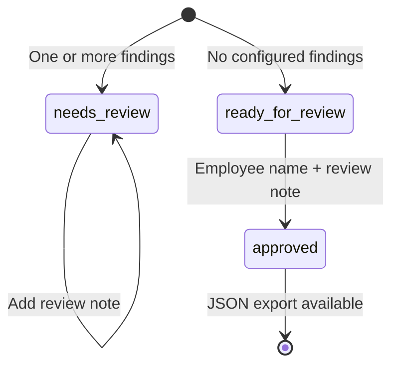

# Architecture

Status: implemented local foundation, 2026-10-15. Live Kimi behavior awaits an account-key run.

The diagram is available as [editable SVG](assets/architecture.svg),
[Mermaid source](architecture.mmd), and a PNG suitable for a GitHub README.
`scripts/create_diagram.py` generates both images.

ECC supplied development guidance and specialist review roles for architecture, provider
reliability and security. It is not a runtime dependency or an agent team inside FreightLens.
See [the architecture audit and resolved findings](architecture-audit.md).

## Business goal

Help a freight employee compare the agreed shipment details with the invoice and delivery record.
Reduce repeated retyping and make discrepancies visible with supporting evidence.
The application records a review decision; it does not make a payment decision.

## Decisions and trade-offs

### One Python application with clear module boundaries

FastAPI serves both the HTTP API and a lightweight HTML/CSS/JavaScript interface. One process
is easier to run, debug, and explain than separate services. The trade-off is synchronous document
processing and limited throughput. A queue/worker becomes justified when concurrent business usage
exists. Streamlit was considered, but a same-origin interface exercises a real HTTP API without
requiring a second application process. A Java backend would fit the owner's existing experience;
Python aligns with the role's practical test and makes the learning gap concrete.

### AI extraction behind a small interface

The extractor accepts a declared document type and numbered pages, and returns validated fields
with quotes. The demo parser, Gemini adapter and Kimi adapter implement this contract. Each adapter has
no tools, database access, or authority to change review state. New providers can implement the
same interface. The demo parser is useful for repeatable workflow tests, but says nothing about
model accuracy on unfamiliar layouts.

### Deterministic business logic

Money uses `Decimal`, and currency must be explicit. Required fields, reference consistency,
charge comparison, strict calendar dates, and chronology within each document and across the
rate pickup/POD delivery are plain Python functions. Planned and actual delivery dates need
not be identical: late delivery is a separate business question. Using an LLM as the final judge
would make regression checks less predictable. This design limits model influence but cannot
eliminate extraction mistakes or semantic mislabeling.

### Evidence is a condition for retaining an extracted field

The quote must exist on the indicated page, and the value must have textual support in that
quote. Identifiers and currency codes need complete-token boundaries. Amount formatting can
differ only if a complete monetary token parses to the same decimal value; negative signs
and accounting parentheses cannot support a positive amount. Unsupported
fields are dropped and flagged. This is a text-grounding check, not proof that the field's meaning,
document type, signature, or business claim is correct. Employee source review remains necessary.

### SQLite for the local milestone

SQLite avoids infrastructure setup and supports transactional approval updates. Parameterized
queries protect query structure, and connection lifetimes are explicit. Review objects are
stored as validated JSON for a small prototype. PostgreSQL plus normalized document/field/event
tables would support reporting, migrations, and multiple users when needed. The current history
is chronological and application-managed, not tamper-proof.

### Explicit review state

Employees can confirm currency/dates with source evidence, a name and a reason. Original AI
fields remain unchanged; separate confirmations provide the values used for validation.
Every confirmation reruns checks and records original/previous/new values. Only the targeted
currency/date issue and its corresponding discarded-field warning can be resolved this way.
Missing documents and unrelated discrepancies still block approval. Other corrections require
a new packet. Adding a note alone cannot clear findings. A packet is never automatically approved.
Repeated approval attempts return a conflict. Export checks persisted state on the server.
Approval and export require the current pipeline revision. Compatible earlier records can
recheck stored pages and fields with no model request, updating rule provenance and resetting
approval. Incompatible extraction revisions require a fresh upload. Stale edit revisions are
rejected inside the repository transaction. See [confirmation contracts](field-confirmations.md).

### Versioned results and reuse

The packet fingerprint includes provider, configured model, pipeline revision, document types
and file hashes. `versions.py` defines the pipeline, extraction/grounding and rules revisions;
the pipeline revision must change whenever either validation policy changes. New reviews persist
all three revisions and the provider/model in `ProcessingMetadata`. A policy change creates a
new attributable result rather than silently rewriting prior approvals. Older JSON without
metadata loads with `processing=None` and is subject to the recheck gate.

## Data contracts

- `Page`: numbered extracted source text.
- `Evidence`: value, page number, and exact supporting quote.
- `Document`: declared type, file hash, page text, supported fields, warnings.
- `Issue`: check code, message, related document IDs, optional field.
- `ProcessingMetadata`: provider, configured model, pipeline/extraction/rules revisions.
- `Review`: provider, processing metadata, status, documents, issues, draft, elapsed time, history, approval.
- `Approval`: employee name and review note, with length/nonblank validation.

API payloads and model extraction objects reject unknown properties. The model cannot inject
an `approve` property into the extraction contract. A prompt asks the model to treat document
instructions as untrusted; the stronger control is its lack of action tools and the independent
server approval gate. These controls do not establish complete prompt-injection immunity.

## API surface

| Method | Route | Behavior |
|---|---|---|
| GET | `/api/v1/health` | App version, selected provider and pipeline revision |
| POST | `/api/v1/reviews` | Multipart files plus comma-separated `kinds` |
| GET | `/api/v1/reviews` | Latest 100 reviews |
| GET | `/api/v1/reviews/{id}` | Full saved review |
| POST | `/api/v1/reviews/{id}/notes` | Save employee note |
| POST | `/api/v1/reviews/{id}/confirmations` | Confirm currency/date with source evidence and rerun validation |
| POST | `/api/v1/reviews/{id}/recheck` | Recheck compatible saved fields under current rules; reset approval |
| POST | `/api/v1/reviews/{id}/approval` | Approve a packet without findings |
| GET | `/api/v1/reviews/{id}/export` | Download approved JSON |
| POST | `/api/v1/demo/{scenario}` | Load a synthetic demo packet |

An identical packet with the same provider/model/pipeline revision returns its existing review
with HTTP 200; a newly stored review returns HTTP 201. Duplicate bytes inside one packet return
409. Concurrent identical requests may both call the provider before SQLite resolves the unique
fingerprint; a job lock is future work. This is not a guarantee of single billing under concurrency.

## Trust and deployment boundary

Server binds to loopback. Host validation and a same-origin write boundary protect local browser
use. An outer ASGI middleware counts actual incoming bytes, including requests without
Content-Length, before multipart parsing. Oversized requests return 413; partially opened upload
files are closed. Per-file, page and extracted-text limits apply afterward. These controls do
not bound the time or memory needed to decompress and parse a PDF.

The app has no user authentication, public hosting, cross-user isolation, parser process
isolation, secure data retention, or application-wide rate limiter. File limits reduce routine
load but do not guarantee bounded PDF decompression memory. Sensitive real documents and public
deployment require a separate hardening milestone.

## What the first milestone proves

The local workflow, checks, state transitions, persistence, and export gate work with synthetic
documents. Mocked provider tests cover schema validation and upstream failures. A small
[live Gemini evaluation](external-pdf-evaluation.md) exercised public PDFs and found a remaining
multi-invoice ambiguity failure. A subsequent scope check now catches that guide and labeled
invoice bundles before extraction; it is not a universal classifier. Unambiguous slash dates with four-digit years validate;
ambiguous day/month order and two-digit years require an explicit employee confirmation. Original source values
and quotes are preserved. A live Kimi evaluation, OCR, real integrations, a representative
held-out evaluation set, and business impact measurements remain to be completed.
