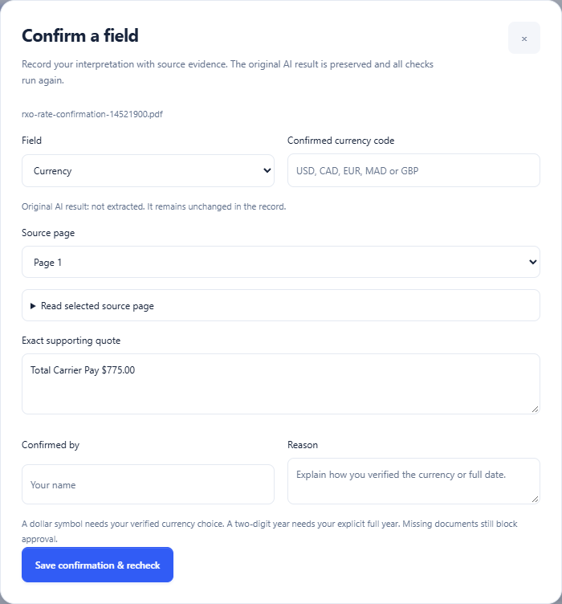
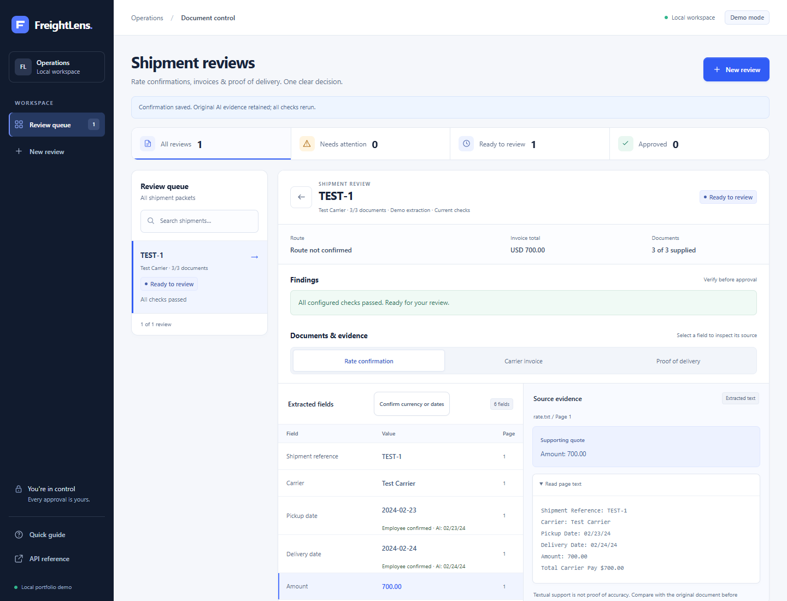

# Employee confirmations and document-scope checks

Implemented in policy `2026-10-15.4`. The original AI extraction is retained; employee
interpretations are saved separately and every accepted change reruns validation.

## Use it in the interface

1. Open a review and select a document. If it uses an older compatible policy, choose
   **Recheck saved pages** first. This uses stored text and fields without a model request.
2. Choose **Clarify this field** on a currency/date finding, or **Confirm currency or dates**.
3. Choose the field and enter the currency code or full date (`YYYY-MM-DD`). Select the
   source page and provide an exact quote. The page text is available in the form.
4. Enter your name and a reason explaining how you verified the interpretation.
5. Save. The app reruns all checks and updates the clarification draft. Approval is still
   a separate action and remains blocked when documents or other required information are missing.

The actual public RXO review is unchanged apart from a rules recheck. No USD or century
assumption was saved to it. A real reviewer must verify those details before confirming them.

## What is checked

- Currency must be a supported code and supported by the cited code/symbol. A dollar sign
  can support an employee's verified USD or CAD interpretation; it does not choose one automatically.
- A full date must match the printed date components. Two-digit years can be interpreted
  explicitly by the reviewer, and ambiguous day/month order can be resolved explicitly.
- Quotes must exist on the selected page. Invented quotes/pages and incompatible values fail.
- Only currency, pickup date and delivery date can be confirmed through this endpoint.
- Missing documents, unrelated extraction warnings, amount mismatches and chronology checks
  still block approval. The form cannot change an amount or manufacture a missing document.
- Approved records reject field edits. Rechecking invalidates an earlier approval and requires
  a new employee decision. Stale revision numbers are rejected to prevent lost updates.

The local prototype still uses self-reported reviewer names; this is not authenticated identity
or a tamper-proof audit log. Source support checks do not replace an employee's judgment.

## Data and API

`Document.fields` remains the original accepted extraction. `Document.confirmations` stores
the latest employee-confirmed evidence for each eligible field. Validation and the interface
use the confirmations overlaid on original fields. JSON exports contain both representations.

`Review.confirmations` appends each change with reviewer, reason, page, quote, original value,
previous value and new value. `Review.audit` also records the action. Remaining issue IDs are
stable across corrections, so clearing one finding does not relabel another finding's history.

| Route | Behavior |
|---|---|
| `POST /api/v1/reviews/{id}/confirmations` | Confirm one eligible field with an expected revision; rerun all checks atomically |
| `POST /api/v1/reviews/{id}/recheck` | Recheck compatible saved extraction, update rule provenance and invalidate old approval |

Recheck retains the configured model and extraction revision; it does not claim to have
rerun the AI. Incompatible or absent extraction metadata requires a fresh upload.

## Verification on the public PDFs

The saved Wayfinder, RXO and FedEx reviews were rechecked without changing their original
AI fields or source text. In an isolated copy of the actual RXO extraction, simulated
employee confirmations of USD and full 2024 dates reduced findings from **5 to 2**.
Approval stayed blocked because the invoice and POD were still missing. These interpretations
were demonstration assumptions, not verified carrier billing instructions, and were not
applied to the actual saved public review.

The original six-page FedEx guide was also uploaded into an isolated test. Its short
explanatory cover triggered `unsupported_document_scope`, fields stayed empty, and the
provider was not called. The guard also handles multiple distinct explicitly labeled invoice
IDs. Repeated references to the same invoice are accepted. These heuristics do not identify
every possible guide, scan, unlabeled bundle or mixed transaction document.

- [Recorded public-PDF recheck and isolated confirmation results](confirmation-workflow-results.json)
- [Original live inference evaluation, including the earlier failure](external-pdf-evaluation.md)

## Browser and regression verification

A separate local demo instance used fictional text fixtures to exercise a full user journey:
reject an unsupported currency, retain entered data after the error, save three confirmations,
reach `ready_for_review`, require separate approval, export, and lock the approved record.
The original AI date stayed `02/23/24` while the confirmed value became `2024-02-23`.

The confirmation dialog was checked at 1440, 768 and 390 pixels without horizontal overflow.
No JavaScript page errors occurred. An HTTP 422 was deliberately triggered to test rejection.
The full Python suite passed **148 tests with 97.95% coverage**; lint, formatting and type
checks are recorded in [verification notes](verification.md).
