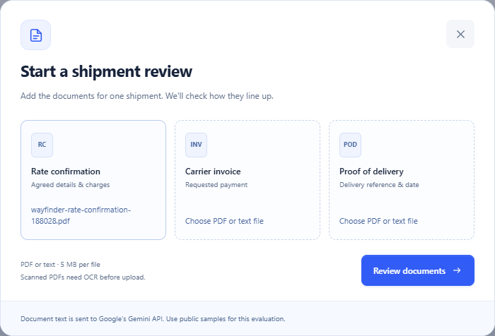
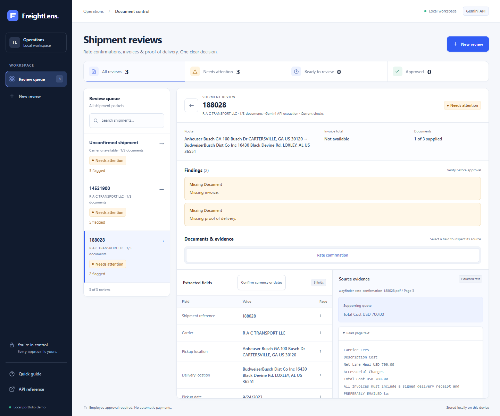
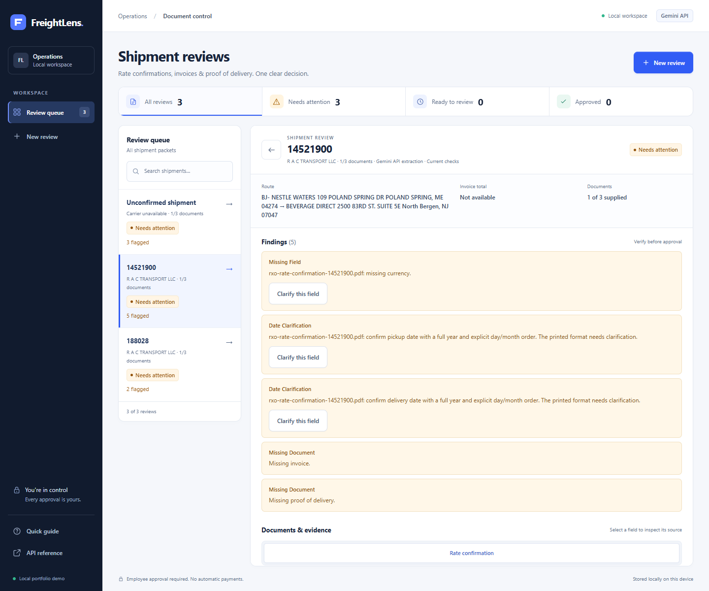
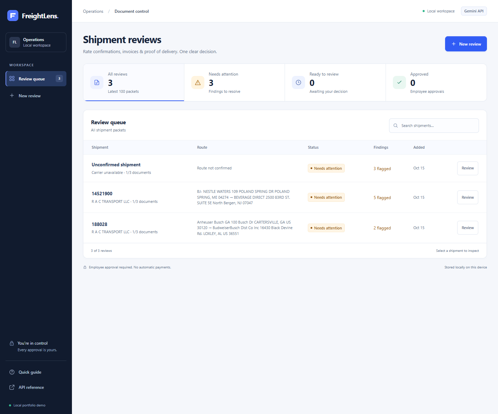
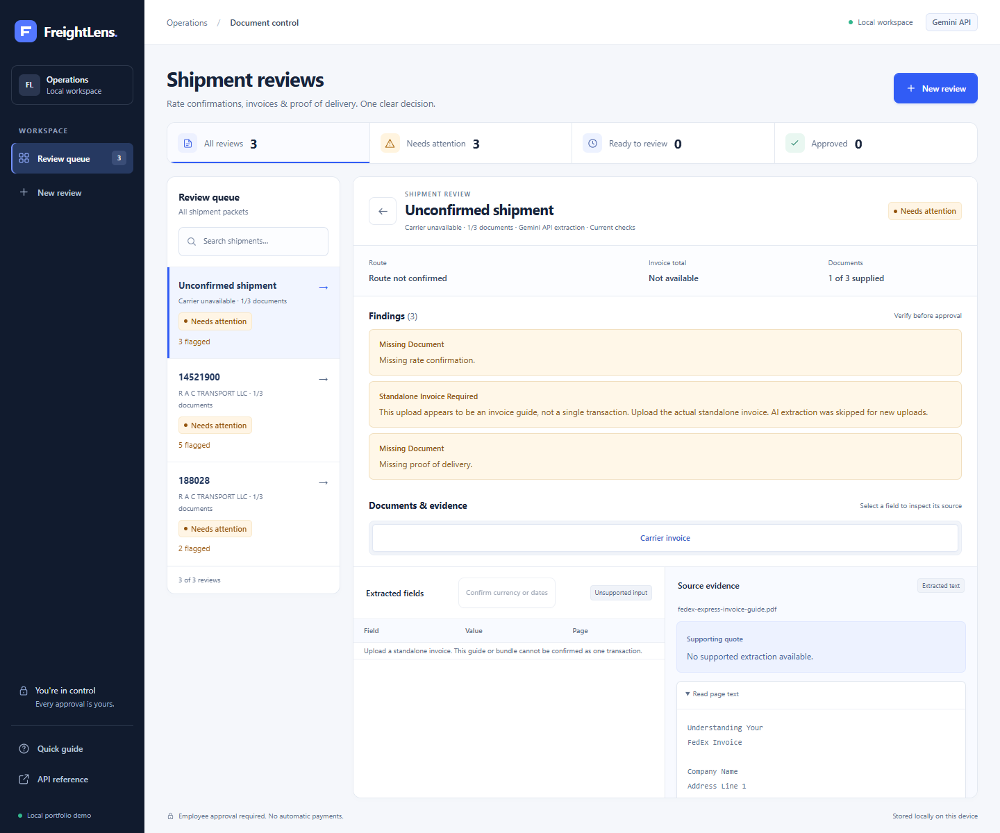

# From a public PDF to a reviewable result

This walkthrough uses original third-party freight PDFs downloaded on 15 October 2026.
The screenshots show FreightLens running locally with Gemini and real saved extraction
results. No source PDF was generated, filled or edited for this demonstration.

## The input document

The first example is the three-page [Wayfinder rate confirmation for load 188028](https://www.grouprac.com/Documents/188028Rate%20Confirmation.pdf),
publicly hosted by GroupRAC. Its carrier-pay table is on page 3. The before/after comparison
in step 3 shows a direct render of that original page beside the extracted application result.

The downloaded PDF's SHA-256 is
`214319cf1e30de49f6b79dca890e1ece375136afb61124ea376c74935fadeb5b`.

## 1. Upload the file

Select the original PDF under **Rate confirmation**, then choose **Review documents**.
Only one document is supplied in this example, so the application will also report the
missing invoice and proof of delivery.

## 2. Read and extract

`pypdf` reads the text already embedded in the PDF, preserving page numbers. Gemini receives
that numbered text and returns fields such as shipment reference, carrier, route, dates,
amount and currency, with a supporting source quote for each value.

Python validates the response schema and checks each quote against its cited page. An
unsupported quote or value is discarded and becomes a review warning. Reading this text
is not OCR; image-only scans need a separate OCR step before upload.

## 3. Verify the amount against the page

Selecting **Amount** opens its page-3 evidence. The accepted value is **700.00**, the currency
is **USD**, and the quote is **Total Cost USD 700.00**. The dates and other fields keep their
original source values. All eight checked values matched the manually inspected document.

| Before: the original PDF page | After: the extracted fields and source evidence |
|---|---|
|  |  |

Click either image to inspect it at full size. The source page is a direct PDF rendering;
the result is a real browser screenshot. Neither image substitutes or invents document values.

| What is visible in the source | What FreightLens retained |
|---|---|
| `Total Cost USD 700.00` on PDF page 3 | `amount: 700.00`, `currency: USD`, `page: 3`, and the exact source quote |

Exact textual support does not guarantee that an AI selected the right meaning, so the
employee still compares the fields with the original document. This particular record stays
blocked because no invoice or signed delivery record was uploaded.

## 4. Surface review requirements on another layout

The separate [RXO rate confirmation for load 14521900](https://www.grouprac.com/Documents/14521900Rate%20Confirmation.pdf)
yielded seven checked fields, including **775.00** carrier pay. Its source uses a dollar
symbol without an explicit currency code, and dates such as **02/23/24**. Current policy
requires an explicit currency and a four-digit year, so those items remain for review.

These findings describe what the application needs before approval; they are not a claim
that the carrier's document is malformed. A review note alone cannot clear a finding.

## Where the approval blocks come from

The Python validation rules create findings; Gemini does not decide whether to approve a
record. The API refuses approval and export while findings remain. “Date clarification”
describes our format policy, not an assertion that the printed date is factually incorrect.
Currency/date findings can now be resolved with an explicit employee confirmation and source evidence.

| Finding | Origin | Meaning |
|---|---|---|
| Missing invoice / proof of delivery | Our test setup and the configured three-document packet requirement | We uploaded only a rate confirmation. The other documents were not supplied; the original PDF does not need to contain them. |
| Missing explicit currency code on RXO | Source notation plus our conservative currency policy | The amount was extracted correctly as `775.00`, but `$` alone is not accepted as an explicit `USD` code. |
| Two-digit years on RXO | Our current date-format policy | `02/23/24` is readable and was extracted. Our validator does not infer the century, so it requires clarification. |
| FedEx guide scope | Earlier model limitation, now guarded before extraction | The short guide cover triggers a standalone-invoice requirement. New uploads skip model extraction. Multiple distinct labeled invoice IDs are also blocked; other layouts need broader evaluation. |

The first three rows are not evidence of damaged PDFs. The FedEx row records the original
failure and its new preflight guard. The employer has not supplied its approval policy, so the strict
rules are prototype choices rather than confirmed company requirements. No matching real
invoice/POD packet was available for these two shipments.

## 5. Keep the work visible

Each uploaded review is stored in SQLite with its fields, page text, findings and processing
metadata. The queue below includes the two rate confirmations and the separate FedEx guide
test. There are three reviews, zero approvals, and no payment or email has been sent.

## 6. Clarify a field with a recorded confirmation

Choose **Confirm currency or dates**, or **Clarify this field** on a finding. The form shows
the original AI value and asks for the confirmed value, source page, exact quote, reviewer
and reason. This screenshot shows the actual RXO form before any interpretation is submitted.

Accepted confirmations are saved separately from original AI fields. Checks rerun, the draft
updates and approval remains a separate employee decision. The [workflow test](field-confirmations.md)
records RXO's five-to-two finding reduction on an isolated copy, not the actual saved review.

## 7. Block the known invoice guide explicitly

The short explanatory cover now triggers the document-scope guard. Historical AI fields
remain stored, but are not displayed as accepted transaction facts. New uploads skip extraction.

Distinct labeled invoice IDs also trigger the guard. These are conservative text checks,
not a guarantee to classify every invoice bundle.

## What this demonstration proves

- The original PDFs can be uploaded through the interface and read with page provenance.
- Gemini produced the checked rate-confirmation fields, including both carrier-pay amounts.
- Accepted values are presented beside source quotes for employee verification.
- Missing or ambiguous required information keeps approval and JSON export blocked.
- Reviews persist and identical uploads reuse the existing result.

The current screenshots show saved live extractions rechecked under policy `2026-10-15.4`.
The upload image shows file selection only. Capturing these screens made no new model calls
or employee confirmations. Screenshots contain no substituted fields or findings.
The source-page image is a PDF rendering rather than a browser capture.

This does not demonstrate a complete matched rate/invoice/POD packet or general extraction
accuracy. The original FedEx guide inference was inconsistent; the current preflight now
blocks that guide before a new model call. See the
[live evaluation and reproduction commands](external-pdf-evaluation.md) for the full results,
including the initial run and corrections.

[Back to README](../README.md)
