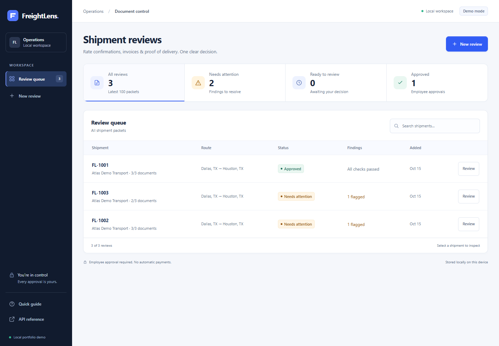
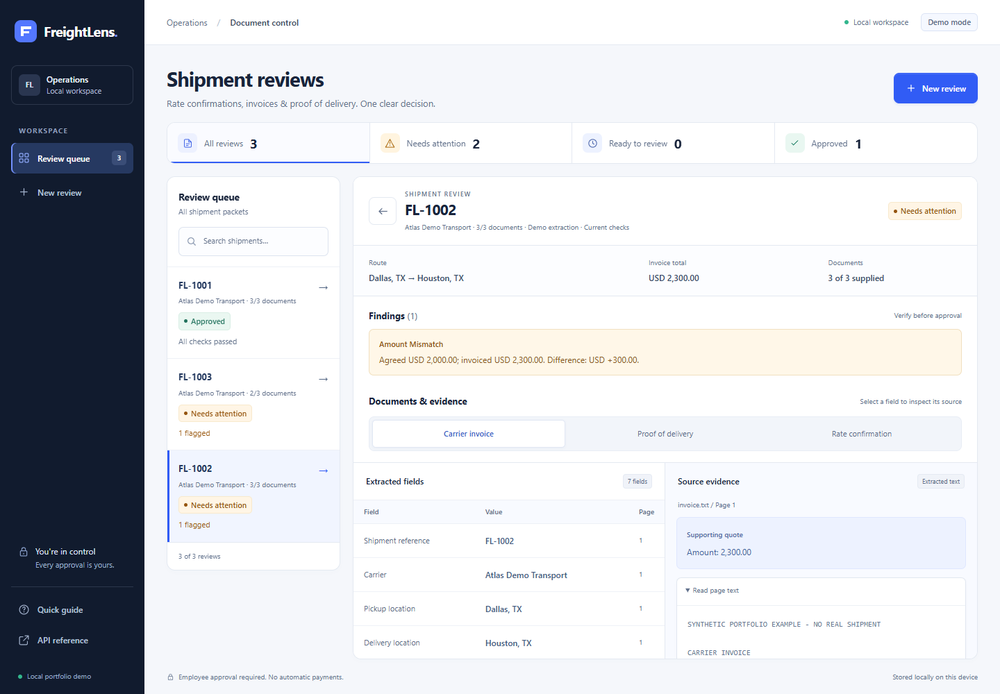

# Local verification

Verified on 2026-10-15 on Windows, Python 3.14. The pinned package environment is in
`requirements-dev.lock`. The table records local results; Linux CI results are linked below.

## GitHub Actions

[The first published CI run](https://github.com/redajausef/freightlens/actions/runs/38795050974)
passed on `ubuntu-latest` with Python 3.11 and 3.14 at commit
`b184cb87b8612eec783f43231124780b5f3e0415`. Both jobs passed dependency installation,
editable installation, Ruff lint/format, Pyright and the pytest coverage gate. The README
badge links to the latest workflow status; this link preserves the recorded run's evidence.

## Local checks

| Check | Result |
|---|---|
| pytest | 148 passed |
| Application line coverage | 97.95% (733 statements, 15 missed) |
| Ruff lint | Passed |
| Ruff formatting | Passed |
| Pyright | Passed: 0 errors, 0 warnings for `src` and `run.py` |
| Distribution build | Passed: wheel contains application modules, static UI and sample text fixtures |
| Synthetic PDF upload | Passed: extracts PDF page text and matches expected packet state |
| Browser mismatch workflow | Passed: USD 300 difference shown; approval disabled |
| Browser approval workflow | Passed: clean packet requires name/note; approval enables JSON export |
| Browser policy transition | Passed: older records show recheck required, approval disabled/export hidden; fresh record records current policy and downloads after approval |
| Responsive browser check | 390 px viewport, 390 px document width; no page-level horizontal overflow |
| Browser JavaScript | No application script errors; the controlled 503 fixture produced an expected network error |
| Live NVIDIA / Kimi inference | Not run: account API key not configured |
| Live Gemini extraction | Two public rate confirmations: 15 checked field values matched; multi-invoice guide ambiguity check failed and approval stayed blocked. [Results](external-pdf-evaluation.md) |
| Gemini browser check | Provider label and three actual API-created reviews visible; source quote on Wayfinder page 3 opens; no console errors or warnings |
| Currency/date confirmations | Original values preserved; 3 simulated confirmations on an isolated public RXO copy reduced 5 findings to 2; missing-document approval stayed blocked |
| Scope guard on actual FedEx PDF | Six-page guide explicitly blocked before extraction; provider not called |
| Confirmation browser journey | Fictional fixture: invalid currency rejected with input retained; 3 confirmations, separate approval/export, approved edit lock; no page script errors |
| Confirmation responsive check | Dialog/page contained at 1440, 768 and 390 px; expected HTTP 422 used for rejection test |

One upstream test-harness deprecation warning is emitted by Starlette about its httpx test
client compatibility path. It does not fail the tests; it is separate from the browser console.

## Clean GitHub delivery check

The prepared source was copied without `.env`, runtime databases or caches, then installed
in a newly created virtual environment using the README's pinned-dependency and editable
installation commands. The clean copy passed all 148 tests (97.95% application coverage),
Ruff lint/format, Pyright and JavaScript syntax checks on Windows/Python 3.14.

Without any API key, actual synthetic PDF uploads reproduced all three packet states:
matching documents required separate approval before export; mismatch and missing-POD
packets returned HTTP 409 for approval/export. Static assets and API documentation served
successfully. The public download helper fetched all three publisher files and verified
their recorded hashes. Its non-PDF, changed-hash, oversized-response and existing-file
guards were also exercised. The offline public-PDF evaluation saved results under `data/`
without replacing the committed live evidence. No new live model requests were needed.

All relative Markdown links resolved, the ZIP integrity check passed, and the delivery
was checked for the locally configured API keys and excluded runtime files. See the
[machine-readable smoke result](github-package-verification.json).

## Current modern interface checks

The interface was rebuilt around a queue-first workspace, native New review dialog and
focused queue/detail layout. ECC workflow and accessibility reviews informed the implementation;
Codex implemented and integrated HTML, CSS and JavaScript. Reference principles and the
product contract are in [design notes](design.md).

Actual browser checks cover PDF upload, discrepancy/missing-document approval blocks, source
navigation, note saving, per-shipment memory drafts, source selection after saves, employee
approval and a real JSON download. Controlled routes cover pending health/upload requests,
startup 503/Retry recovery, provider errors with files retained, and long-content containment.
Real older-policy records cover recheck feedback and blocked approval/export. Expected network
errors occurred for the controlled 503 fixtures; no application script errors occurred.

Rendered inspections cover 1440x1000,1024x900,390x844. Keyboard checks cover skip/main focus,
review-title focus, modal cycling/Escape/opener return, compact navigation labels and search.
Computed text-color contrast checks found no failures in tested queue/review/upload surfaces
after fixes, excluding decorative/disabled content. Reduced motion and viewport containment
were checked. These checks do not certify accessibility.

The local ECC checker passes [the current evidence record](design-evidence/modern/evidence.json).
Its completeness validation complements rendered inspection; it cannot judge visual quality.
Earlier interface evidence is retained separately as historical material.

## Meaningful covered failures

- Incorrect amounts, mismatched references/carriers/locations/currencies, missing documents/fields.
- Decimal cent precision, invalid and negative amounts, invalid dates and delivery before pickup.
- Duplicate bytes, repeated packet reuse, unsupported types, unreadable PDFs, encryption, blank
  pages, invalid UTF-8, excessive file/page/text sizes.
- Unknown/invented source quotes, unsupported values, and nonexistent cited pages.
- Provider authentication/rate-limit/server errors, bounded retries, network failure, invalid
  output, unfinished responses, and unknown model output properties such as `approve`.
- Blocked export before approval, blocked mismatched approval, duplicate approval rejection,
  nonexistent review IDs, invalid issue references, transaction rollback and intact review history.
- Local browser origin/host boundaries and request size check.
- Oversized fields and conflicting repeated values in the deterministic demo parser.
- Positive model amount against a negative/accounting source quote; truncated identifiers/currencies.
- Invalid unrelated numeric tokens preceding a valid supported amount; malformed provider envelopes.
- Strict calendar format and within-document chronology, while permitting a later actual delivery.
- Revision-aware packet reuse and persisted model/policy provenance.
- Legacy records remain readable but cannot be approved or exported under the new policy.
- Actual streamed request limits without Content-Length and cleanup of partial multipart temp files
  using a direct multi-chunk ASGI request (not only TestClient's coalesced request body).

See [the ECC audit](architecture-audit.md) for the reproduced failure mechanisms and fixes.

## Screenshots

## What these results do not establish

Line coverage is not AI extraction accuracy. Three simple synthetic templates are workflow
fixtures, not a representative logistics dataset. Live model extraction quality, cost, latency,
prompt-injection robustness across adversarial documents, production load,
and real business impact still need their own evidence.
